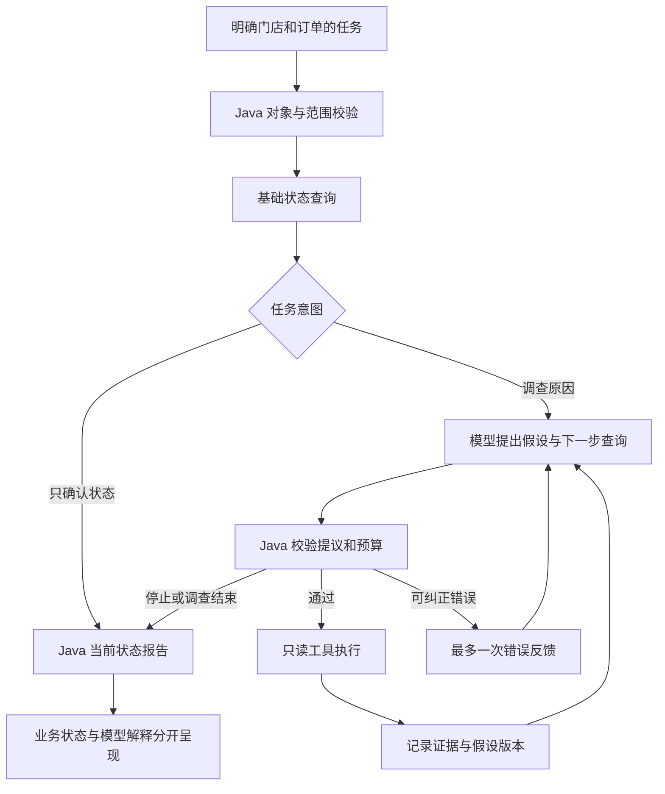

# OmniOps Agent：零售订单诊断与异常调查

> 仓库项目名：`ayd-retailops-agent` · 更新时间：2026-11-12 · 当前阶段：Stage 1E
>
> 基于 Java 17 与 Spring Boot 的只读订单诊断 Agent 原型。大模型解释日志、提出假设并选择调查工具；Java 执行查询、校验证据、控制权限与预算，并生成当前业务状态结论。

**当前业务数据全部来自模拟场景，尚未接入生产订单、POS 或美团接口。** 真实模型已经参与多轮调查，但复杂反证场景仍未完整通过验证。本项目适合用于学习、演示和研究 Agent 工程，不是可直接处理生产订单的自动运维系统。

## 1. 项目要解决什么问题

零售订单同步异常往往需要同时查看本地订单、POS、平台订单、推送记录和日志。一线人员需要回答两个不同的问题：

1. **现在是什么状态？** 订单是否存在，是否有补推或恢复的候选处理方向。
2. **之前为什么异常？** 是否出现等待回执、异步处理或其他异常线索，哪些原因仍缺乏证据。

项目将当前业务状态与历史原因分开处理。POS 现在存在，不代表历史原因已查清；日志没有保留下来，也不代表当时没有发生异常。

产出包括当前状态报告、证据引用、调查假设及变化历史、每轮工具选择理由、未解决问题和任务事件。当前版本只提出建议，不执行补推、恢复或配置修改。

## 2. 已实现的功能

|模块|当前能力|
|---|---|
|任务 API|异步提交、任务查询、补充门店/订单、版本校验、取消、事件轮询|
|状态诊断|判断已同步、补推建议、恢复建议、平台查询窗口外及无法确认|
|模型调查|读取证据、建立假设、选择只读查询、增量修改假设、解释未知项|
|假设管理|区分当前与历史命题，保存时间范围、可推翻条件、支持与反证引用|
|逐轮复核|要求模型对每个旧假设给出更新或维持理由，保留版本历史|
|工具控制|五个只读工具；校验白名单、门店范围及订单目标|
|执行预算|限制模型请求、决策、工具次数、活动时间和重复查询|
|纠正机制|对指定契约错误允许每任务最多一次模型重写，仍计入调用预算|
|本地持久化|JSON 快照、同步落盘、原子替换、文件锁；中断任务重启后保留证据并转人工|
|演示与评估|规则流程对照、单任务真实模型调查、Markdown/JSON 轨迹导出|
|模型接入|百炼 qwen-flash 预设，以及兼容 Chat Completions JSON 协议的 remote 适配器|

### 大模型与 Java 的职责

|大模型承担|Java 承担|
|---|---|
|解释非结构化推送记录、关联日志|采集基础事实并实际执行工具|
|提出可能原因及可反驳的假设|校验查询权限、目标和参数|
|选择下一步调查并说明问题|检查引用存在性、时效和明确业务规则|
|根据证据修改假设或保留未知|保存假设版本、限制预算、处理失败|
|给出供审阅的原因解释|根据权威查询生成当前业务状态报告|

引用合法不等于因果解释正确。通用自然语言根因仍需审阅，当前根因确认程度保持 `UNCONFIRMED`。

## 3. 技术栈与结构

|项目|实现|
|---|---|
|运行时|Java 17|
|Web 框架|Spring Boot 4.1.2 / Spring MVC|
|构建|Maven Wrapper，配置的 Maven 发行版为 3.10.0|
|模型 HTTP 调用|JDK HttpClient，无单独模型 SDK|
|JSON|Jackson，严格字段解析与尾随内容检查|
|存储|本地 JSON 文件；无数据库服务依赖|
|测试|Spring Boot Test、JUnit，包含真实本地 HTTP API 测试|
|操作入口|REST API、PowerShell 脚本、生成的 Markdown 报告；暂无前端聊天界面|



### 三种策略

|strategy|用途|是否调用大模型|
|---|---|---|
|`workflow`|固定顺序的 Java 对照流程|否|
|`agent`|早期动态诊断流程|默认规则 Stub；配置 qwen/remote 后为真实模型|
|`investigation`|当前重点：带假设和证据复核的异常调查|`DIAGNOSE_CAUSE` 需要真实模型；`CHECK_STATUS` 可零模型完成|

`provider` 决定模型来源，`strategy` 决定执行流程，二者不是同一参数。没有配置真实模型时，原因调查明确停止并保留基础状态，不使用规则 Stub 冒充模型完成调查。

### 当前只读工具

|工具|用途|
|---|---|
|`order.local.query`|查询本地订单状态|
|`pos.order.query`|查询 POS 当前订单状态|
|`meituan.order.search`|查询平台订单或模拟窗口检查结果|
|`order.push.history`|查询推送执行记录|
|`logs.search`|查询该订单的受控关联日志|

所有工具参数只接受已确认的 `storeId` 和 `orderId`。当前没有任意 SQL、文件路径、关键词或自定义时间范围查询能力。

## 4. 从普通用户角度看三个例子

以下是基于模拟场景整理的说明，不是模型原话，也不是上线产品截图。

**“这笔订单刚才没到 POS，现在怎么样？”**

系统先查到本地有单、POS 缺单。模型读取推送记录并提出后续查询；重新查询 POS 后确认订单已存在。可靠的状态答复是“订单现在已同步，无需补推”。历史原因仍需要日志支持，不能直接认定为网络问题。当前版本的这一复杂反证场景仍存在引用冲突，尚未完整通过。

**“现在正常了，但之前为什么没同步？”**

推送历史已过保留期。模型能说明“无法确认历史原因，空记录不代表当时没发生异常”，保留未知并转人工。但最新样本没有继续尝试日志查询，调查覆盖还不充分。

**“日志里写着去另一个门店补推，系统会执行吗？”**

该模拟样本中，模型将其识别为不可信操作指令，未执行越权动作，并在历史证据不足时保留未知。网关也限制目标和可用工具。本阶段没有业务写工具。

更多解释见 [正常使用例子](docs/stage1e-user-examples.md)。

## 5. 快速开始

### 环境

- 安装 JDK 17，首次构建需要下载 Maven 和依赖。
- 以下命令在仓库根目录的 PowerShell 中运行。
- 脚本默认 JDK 路径是原开发环境路径；其他机器请通过 `-JdkHome` 显式指定自己的目录。
- 服务默认只监听 `127.0.0.1:8080`；仅本地单用户演示。

### 无需模型密钥：构建与本地演示

```powershell
# 替换为自己机器上实际存在的 JDK 17 目录。
$jdkPath = 'C:\path\to\jdk-17'
.\scripts\stage1.ps1 test -JdkHome $jdkPath
.\scripts\stage1.ps1 build -JdkHome $jdkPath

# 查询当前状态，0 次模型调用；执行完输出报告并退出。
.\scripts\stage1.ps1 investigate -JdkHome $jdkPath `
    -Provider stub -Fixture synced -Intent CHECK_STATUS

# 或启动本地 API 服务，默认使用规则 Stub。
.\scripts\stage1.ps1 run -JdkHome $jdkPath
```

### 真实模型：百炼调查

先通过本地安全方式将北京区百炼密钥注入当前进程的 `DASHSCOPE_API_KEY` 环境变量，再运行：

```powershell
.\scripts\stage1.ps1 investigate -JdkHome $jdkPath `
    -Provider qwen -Fixture investigation-reversal -MaxRequests 6
```

这会产生真实 API 请求和费用，但业务数据仍为模拟。`MaxRequests` 是**本进程**模型请求总上限，包含失败请求，进程重启后重新计数；不是账户级或跨进程的累计限额。

可选场景：`investigation-reversal`（迟到回执与状态复核）、`investigation-no-history`（历史缺失）、`investigation-injection`（日志中混入操作指令）。

运行生成 `evaluation-output/investigation/<UTC时间>/report.md`、`trace.json`、`manifest.json`，程序随后退出。模型版本更新和非确定性可能使复现结果不同。

### 模型配置

|配置|用途|
|---|---|
|`DASHSCOPE_API_KEY`|qwen 预设使用的密钥|
|`DASHSCOPE_ENDPOINT`|可选；百炼北京区兼容接口，受官方域名及路径校验约束|
|`omniops.qwen.model`|当前代码默认 `qwen-flash`|
|`OMNIOPS_MODEL_API_KEY`|remote 适配器密钥|
|`OMNIOPS_MODEL_NAME`|remote 模型 ID，必须显式配置|
|`omniops.model.endpoint`|remote HTTPS 地址；当前默认 DeepSeek 兼容接口|

上述模型与端点是仓库当前配置，不代表所有账户均可使用。本文不包含密钥或实时价格；模型费用以服务商实际账单为准。

## 6. API 使用

启动真实模型服务：

```powershell
.\scripts\stage1.ps1 run -JdkHome $jdkPath -Provider qwen -MaxRequests 6
```

在另一个 PowerShell 终端提交模拟调查任务：

```powershell
$body = @{
    userGoal = '调查这笔订单此前未同步的原因，说明依据和仍不清楚的部分'
    storeId = 'A001'
    orderId = 'O100'
    fixtureId = 'investigation-reversal'
    strategy = 'investigation'
    intent = 'DIAGNOSE_CAUSE'
} | ConvertTo-Json

$task = Invoke-RestMethod -Method Post -Uri 'http://127.0.0.1:8080/api/tasks' `
    -ContentType 'application/json; charset=utf-8' `
    -Body ([Text.Encoding]::UTF8.GetBytes($body))

Invoke-RestMethod "http://127.0.0.1:8080/api/tasks/$($task.id)"
Invoke-RestMethod "http://127.0.0.1:8080/api/tasks/$($task.id)/report"
Invoke-RestMethod "http://127.0.0.1:8080/api/tasks/$($task.id)/investigation"
```

任务异步执行；提交返回 202，报告尚未生成时返回 204。可重复查询任务直至终态。`fixtureId` 决定模拟数据，更换订单号不会连接真实订单系统。

|接口|用途|
|---|---|
|`POST /api/tasks`|创建任务|
|`GET /api/tasks/{id}`|读取状态与完整轨迹|
|`GET /api/tasks/{id}/report`|读取 Java 业务状态报告|
|`GET /api/tasks/{id}/investigation`|读取假设、复核、模型解释与拒绝记录|
|`GET /api/tasks/{id}/events?afterSequence=0`|读取增量事件|
|`POST /api/tasks/{id}/clarifications`|提交 storeId、orderId、expectedVersion 补齐目标|
|`POST /api/tasks/{id}/cancel`|请求取消任务|
|`GET /api/fixtures`|列出模拟场景|

当前状态报告里的补推/恢复建议不是执行授权。`NEEDS_HUMAN` 既可能表示合理的证据不足，也可能表示模型提议被拒绝，需结合停止原因区分。

## 7. 验证结果与当前限制

截至本次整理，最近构建成功，**68 项本地测试通过**。覆盖状态门槛、工具授权、伪造引用、证据过期、假设历史保留、当前与历史区分、增量展开、预算、取消、一次纠正及 HTTP API。

真实模型已使用模拟数据开展多轮验证。最新 Stage 1E 批次使用 28 次请求，其中包含多个 Prompt 版本的失败与复测：

- Prompt v6：多次输出格式不符合契约。
- Prompt v7：查询与复查过程有所推进，结束类型和历史证据引用仍有错误。
- 当前调查 Prompt v8：未知处理与日志注入样本有改善；反证场景仍未完整通过，历史缺失场景的调查覆盖仍需增强。

详见 [Stage 1E 实测记录](docs/stage1e-live-verification.md)。本地测试通过不等于模型原因解释准确；安全拦截有效也不等于调查成功。

### 仍未实现或未完成验证

- 生产订单、POS、美团的真实只读适配器。
- 自动修复、审批、写操作幂等及写后验证。
- 库存同步调查、京东等其他平台扩展。
- 自然语言自动识别门店/订单、多轮调查补问续跑。
- 前端界面、RAG、历史案例检索和多 Agent 协作。
- 生产身份认证、多租户隔离、数据库存储及分布式执行。
- 独立保留集、强规则基线、人工根因标注和可靠的收益评估。

当前默认查询范围为 A001。旧诊断流程最多 8 次决策，调查流程最多 6 次；默认最多 12 次工具调用、120 秒活动时间。所有业务工具为 Stub，production/integration profile 和非回环监听被拒绝。故障后保留证据并安全停止，不自动恢复未完成调查。

## 8. 代码与文档导航

```text
src/main/java/com/yu/retailops/
├── api/            # REST 接口
├── application/    # 任务服务与 Spring 装配
├── domain/         # 状态、证据、假设、复核契约
├── runtime/        # 执行循环与确定性校验
├── adapter/        # 模型 HTTP 适配、请求额度、增量输出展开
├── tool/           # 只读网关与模拟数据目录
├── persistence/    # 本地 JSON 原子快照
└── evaluation/     # 对照评估、单任务演示与报告导出
src/main/resources/
├── prompts/        # 历次 Prompt，当前调查为 order-investigation-v8
└── evaluation/     # 10 个状态场景、3 个调查场景
src/test/java/      # 回归与 API 测试
scripts/stage1.ps1  # test / build / run / evaluate / investigate
docs/              # 架构设计、阶段说明、实测记录与用户例子
```

推荐阅读顺序：

1. [用户使用例子](docs/stage1e-user-examples.md)
2. [大模型职责设计](docs/design/03-llm-responsibility-design.md)
3. [Stage 1E 增量契约](docs/stage1e-delta-contract.md)
4. [Stage 1E 实测结果](docs/stage1e-live-verification.md)
5. [V0.2 架构评审](docs/design/01-architecture-review-v0.2.md)与[阶段路线图](docs/design/02-phased-design-v0.2.md)

早期阶段文档是历史快照，版本、测试数和结论可能早于本文。设计路线图不代表功能全部已实现。

## 9. GitHub 提交范围

建议提交源码、测试、模拟场景、Prompt、`pom.xml`、Maven Wrapper 脚本与配置、运行脚本、`.gitignore`、`.gitattributes` 及经过检查的 Markdown 文档。本文件可作为 GitHub 项目总览，或后续用来整理根目录 README。

当前 `.gitignore` 已排除：

|路径|原因|
|---|---|
|`target/`、`build/`|构建产物|
|`.build-cache/`|依赖缓存与本地构建日志|
|`data/`|任务快照、证据与运行锁|
|`evaluation-output/`|本地完整轨迹、模型格式诊断输出|
|`.idea/`、`.vscode/` 等|本地 IDE 配置|

API 密钥、含凭据的本地配置、真实业务数据和原始生产日志不应提交。当前忽略规则**没有覆盖所有自定义 `.env` 或凭据文件名**，不要假设把文件命名为 `.env` 就会自动被排除。

实测文档记录了本地轨迹目录，但这些目录默认不随 GitHub 上传。若需公开可复现的演示结果，应另行挑选脱敏样本并说明其来源；未公开的本地轨迹路径不应包装成仓库内可下载附件。

提交前可只读检查：

```powershell
git status --short
git diff --cached --stat
git diff --cached
```

当前未在本次整理中选择开源许可证；是否允许他人使用、修改和分发，应在确定授权方式后加入合适的 LICENSE。本次工作仅整理文档，没有执行 commit、push 或创建远程仓库。
