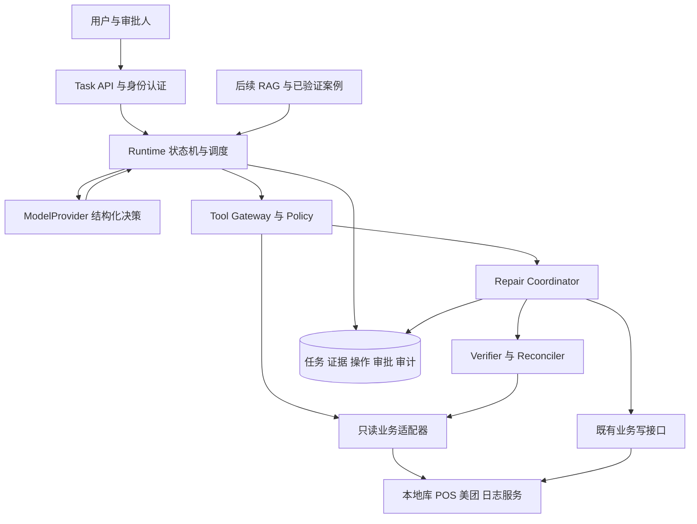

# OmniOps Agent V0.2 架构评审

评审日期：2026-11-11。结论：V0.2 可以作为技术设计基线，建议有条件通过。可启动基础设施与只读诊断设计；生产写操作需在下述阻断项完成后开放。这是技术评审建议，不代表业务审批或已完成实现。

## 1 依据与评审范围

- 基线：`C:\Users\Administrator\Desktop\OmniOps_Agent_项目设计说明书_V0.2.docx`。
- SHA256：`2C74BB8630868D1A20CD71A491041F0EBBD9C8B256AD2757362816C167B37054`。
- 读取了正文、表格与附录；原文没有嵌入图片或修订标记。本次评审针对技术内容，不评审 Word 排版。
- V0.1 未提供。本评审沿用 V0.2 所述业务事实，不声称已独立核实 V0.1、真实接口或生产行为。
- 仓库现状：只有启动类、application.properties、contextLoads 测试及 Maven 骨架；尚未发现 Runtime、业务适配器、数据库迁移或业务测试。
- 本文与配套阶段设计均为新增设计建议，不覆盖原始 V0.2，也不将文档中的操作描述当成执行授权。

## 2 保留的架构与业务约束

保留 V0.2 第 3–5 章的责任边界：LLM 提出调查决策，Java 执行工具、维护状态、实施授权和业务校验。调查顺序允许动态变化；执行前置条件和结果判定必须确定且可测试。

保留单一 Runtime、工具网关、业务适配层、证据账本、假设管理及独立验证。首期采用模块化单体，不因逻辑分层立即拆微服务。业务规则不得绑定模型 SDK 或 Agent 框架。

业务不变量：

1. 首期只覆盖美团销售订单与单门店单商品库存；退货与京东延后。
2. POS 查询异常表示未知，不能等同不存在；补推成功以重新查询 POS 为准。
3. 本地缺单时，可通过美团搜索获得完整订单并复用既有恢复能力。五天限制按基线保留，但滚动时间还是自然日、时区及临界点需接口契约确认。
4. 库存目标来自当前本地 `stock`；`sell_status`、`on_sale` 不参与数量计算。
5. 不自动修改本地库存、商品编码、商品映射或门店配置；编码 trim 只用于诊断。
6. 没有历史同步记录时，不能把当前库存不一致解释为已确认的历史同步失败原因。

## 3 评审发现

优先级：P0 为开放相关生产写能力前的阻断项；P1 为对应阶段上线前需落实；P2 为后续增强。V0.2 已提出多项原则，以下重点是补足执行协议，而非声称原文未考虑这些问题。

| 编号 | 优先级与基线位置 | 发现与影响 | 设计决定与关闭证据 |
| --- | --- | --- | --- |
| R01 | P0，第 6、11 章 | 已要求超时不盲重试，但缺少“请求已到下游、结果未落库”的恢复协议；重启可能重复补推 | 分离执行状态与验证状态，引入 UNKNOWN 和对账流程；断电、超时、重复投递故障注入通过 |
| R02 | P0，第 11 章 | 幂等键示例未固定跨任务作用域；本系统互斥无法阻止原同步系统同时写入 | 持久化唯一操作键、对象占用、下游幂等/唯一约束能力清单；明确不能保证跨系统 exactly-once；没有下游保障时仅人工受控处理 |
| R03 | P0，第 6、11 章及附录 A | 审批记录未定义参数绑定、有效期、撤销及执行时重授权；旧审批可能执行新目标 | 审批绑定 operationId、目标、参数摘要、业务版本、策略版本与过期时间；篡改、过期、权限撤销测试全部拒绝 |
| R04 | P0，第 7.3、10.5 节 | 已要求执行前重查库存，但发送与验证间库存仍可能变化；静态相等判定可能误报 | 固定本次目标快照，记录版本/时间，重查本地与平台；漂移标记 SUPERSEDED 并重新诊断；多 SKU 映射及版本能力未明确前不开写 |
| R05 | P0，第 9、17 章 | 恢复方法可能自带 POS 推送，返回错误也可能已提交；真实调用语义尚缺 | 适配器契约写明事务边界、是否自动推送、幂等与超时语义；恢复后查本地和 POS，再决定是否创建补推操作 |
| R06 | P1，第 6 章 | 状态清单未覆盖取消、审批过期、等待重试与重启抢占；COMPLETED 容易混淆诊断完成和业务恢复 | 任务状态、业务结果、操作状态分别建模；版本 CAS、租约、检查点与状态迁移矩阵；旧 Worker 无权推进新版本 |
| R07 | P1，第 6–8 章 | ToolResult 的 SUCCESS 未明确传输成功与业务结果；证据缺少查询覆盖和数据版本 | 增加业务 outcome、完整性、查询范围、sourceVersion、validUntil；仅完整且有权威性的空结果可支撑“不存在” |
| R08 | P1，第 7、11、12 章 | 已有鉴权和注入防护原则，尚无身份传播与对象来源协议 | 服务端生成 AuthContext，按组织/平台/门店过滤查询和报告；模型不能设置权限；对象必须引用用户输入或可信结果，最终执行再次核验 |
| R09 | P1，第 8、12 章 | Evidence 同时包含业务观察、Knowledge、Memory，若只验证引用 ID，历史知识可能被当实时事实 | 分类保存 OBSERVATION、REFERENCE；报告检查引用存在、范围、时效及语义；根因确认与修复效果分开 |
| R10 | P1，第 14、16 章 | Stage 5 才集中列出 Evaluation，容易使早期迭代没有可比较基线 | Stage 0 建 Stub 与安全测试，Stage 1 即运行同工具 Workflow 对照；Stage 5 增强知识和评估规模 |
| R11 | P1，第 15 章与 pom.xml | 文档建议 Boot 3.x，仓库声明 4.1.2；尚无选型变更记录或依赖验证 | 暂不降级，Stage 0 验证现有组合并形成 ADR；若既有客户端不兼容再决策，不仅凭版本不同判错 |
| R12 | P1，第 13、17 章 | 缺少可落地的容量、时延、保留期限和故障降级设置 | 配置化预算、限流、熔断、写操作总开关；部署前给出容量测量与恢复演练记录 |

R01–R05 不阻塞只读原型，但阻塞对应生产写能力。R06–R10 的最小实现属于只读 MVP，不应全部延后。

## 4 建议目标架构

Repair Coordinator 接管获批后的确定性写流程。LLM 不直接调用可执行任意参数的写接口，只提交修复提议。审批后无需再次依赖模型决定是否进行强制验证。Verifier 的业务校验不接受模型“认为成功”作为输入。

首期部署一个应用服务和独立的 Agent 元数据库，数据库持久化待执行工作；后台 Worker 有界执行，API 不持有长连接等待整个任务。多实例能力只有在租约、抢占和故障测试通过后才开启。暂不引入 Redis、MQ、向量库或多 Agent。

外部业务系统继续负责其核心事务。Agent 数据库事务无法与 POS 或美团请求原子提交：本地记录与工作项原子落库，然后发送外部请求，再持久化结果；中途崩溃留下可对账状态。工作项可重复投递，副作用不应因此被重复发送。

## 5 技术选型评审

仓库的 Java 17 与 Spring Boot 4.1.2 在最低 Java 版本上符合官方系统要求；这不证明 Maven 构建、数据库驱动、模型 SDK 或既有客户端已兼容。本次没有运行构建或连接真实业务系统。[Spring Boot 官方系统要求](https://docs.spring.io/spring-boot/system-requirements.html)

建议先保持现有版本，以 Stage 0 构建和集成结果决定是否调整。元数据库候选为 PostgreSQL；若组织已有标准关系库，保持关系模型与唯一约束语义后可替换。数据库种类、版本及连接方式仍是待决事项，不能把候选当作已部署事实。

数据库锁只能保护参与同一协议的访问者，不能自动锁住外部平台或旧同步程序。不要跨网络调用持有长事务；使用短事务领取、持久化操作占用及版本校验。若选 PostgreSQL，锁类型与生命周期按其官方文档实施。[PostgreSQL 显式锁文档](https://www.postgresql.org/docs/17/explicit-locking.html)

模型选择先验证结构化输出、工具调用、中文诊断、网络可达性、脱敏和成本。首期可以评估 V0.2 所建议的 DeepSeek，但本次不指定未经实测的模型版本，不引入 Embedding 依赖。

## 6 需要补齐的外部信息

| 资料 | 责任角色 | 阻塞范围 | 无资料时可继续的工作 |
| --- | --- | --- | --- |
| 本地订单与 POS 的查询键、门店归属、唯一约束、读延迟 | 业务开发、DBA | 真实订单诊断与补推 | DTO、Stub、权限与错误分支测试 |
| 恢复/补推方法入口、事务、副作用、幂等语义 | 业务开发 | Stage 2 真实写操作 | 操作状态机与故障模拟 |
| 美团搜索及 SKU 文档、五天边界、限流、多 SKU 结构 | 平台接入负责人 | 平台联调与库存写入 | 适配器接口和边界测试占位 |
| 库存版本字段、同步函数实际读取目标与并发方式 | 库存开发 | Stage 4 防止过期写入 | 只读比较、漂移测试和日志设计 |
| 身份源、审批角色、门店范围、数据保留与模型出网约束 | 业务负责人、运维 | 生产上线 | 本地身份 Stub 与可配置策略 |
| 部署资源、元数据库、预计任务量和响应要求 | 运维、技术负责人 | 容量与部署设计定稿 | 单实例结构设计与压测方案 |

不索取或写入密码、Token 等秘密；后续联调通过环境配置或秘密管理服务注入。

## 7 评审后的执行顺序

先完成配套阶段设计中的 Stage 0 契约、基线决策与测试夹具，再建设 Stage 1 美团订单只读诊断。Stage 2、4 分别经过订单和库存写能力准入。所有阶段保留证据、权限和回归门禁；RAG、Memory 与多平台扩展不成为首期前置依赖。
