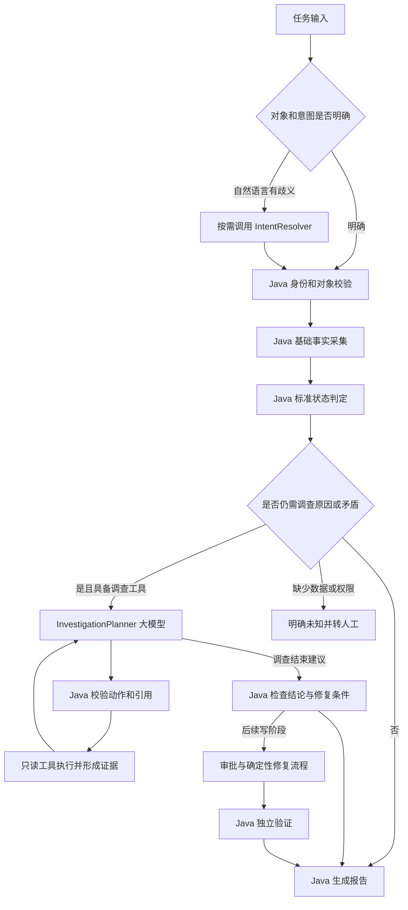

# OmniOps Agent 大模型职责与业务执行设计

日期：2026-11-11。状态：目标设计；核心调查子集已按 Stage 1C 实现，具体范围见 [使用说明](../stage1c-investigation.md)。自然语言入口、生产业务工具和写流程仍未实现。基线为 V0.2、架构评审与当前订单只读原型。

本设计将大模型集中用于异常调查：解释非结构化业务信息、提出可验证假设、选择下一步调查工具，并根据新证据修正判断。标准状态判定、查询执行、修复条件及结果验证由 Java 负责。自然语言入口和报告润色按需调用模型。

这里的“需要模型”表示本项目选择由模型承担该项能力，不表示规则系统在理论上无法实现，也不表示已经证明模型收益。设计先确定职责，后续测试验证质量；不会以验证实验代替功能设计。

## 1 业务流程中的责任分配

| 环节 | 主要执行者 | 是否调用模型 | 具体输入与输出 |
| --- | --- | --- | --- |
| 登录、平台与门店范围校验 | Java | 不调用 | 登录身份与授权范围 → 可访问对象和工具 |
| 表单或 API 提交明确对象 | Java | 不调用 | storeId、orderId、业务类型 → 已验证任务对象 |
| 自然语言理解与歧义识别 | 模型提出候选，Java 核验 | 按需 | 用户描述 → 意图、对象候选、时间表达、缺失项 |
| 确定性基础事实采集 | Java | 不调用 | 已核验对象 → 本地/POS/平台等必要状态证据 |
| 标准状态与已知业务规则判定 | Java | 不调用 | 完整、有效证据 → 当前状态、允许的处理建议 |
| 非结构化日志解释与假设构建 | 调查模型 | 核心调用点 | 脱敏日志、结构化事实、现有假设 → 候选原因、支持/反证、待验证问题 |
| 下一步调查与重新规划 | 同一个调查模型 | 核心调用点 | 证据变化、未解决问题、工具目录、预算 → 一项只读调查动作或停止建议 |
| 执行查询、获取工具结果 | Java 工具网关 | 不调用 | 经校验的动作 → 标准化结果与 Evidence |
| 库存数值比较、映射唯一性等检查 | Java | 不调用 | 权威字段 → 确定性检查结果 |
| 修复提议的业务可行性判定 | Java | 不调用 | 对象、快照、业务条件 → 可执行/禁止/需人工 |
| 修复执行、审批、幂等、超时对账 | Java | 不调用 | 获批的具体操作 → 执行状态及验证状态 |
| 最终业务状态校验 | Java | 不调用 | 修复后的独立查询 → 已验证/不一致/无法验证 |
| 报告事实部分 | Java | 不调用 | 状态、证据、操作、限制 → 结构化报告与固定模板 |
| 面向用户解释调查结论 | 调查模型或可选报告模型 | 可复用末轮输出，必要时再调用 | 已审核的结论与引用 → 易读解释，不改变结果 |

首期不拆出多个独立 Agent。日志解释、假设更新和下一步选择由一次调查模型调用共同完成，避免一条证据先“分析”、再“规划”、再“总结”产生三次请求。

## 2 目标结构与模型入口



对 V0.2 的细化：增加固定的最小事实采集与快速结束路径；异常调查仍按新证据动态选择工具。不会将整个异常调查固化为固定顺序，也不要求每个正常任务为了展示 Agent 而调用模型。

任务意图建议拆成 `CHECK_STATUS`、`DIAGNOSE_CAUSE`、`PROPOSE_REPAIR`。表单可直接指定，自然语言可由 IntentResolver 提出候选。写阶段另行授权；意图为修复建议不代表允许执行。

同样发现“POS 已存在”，CHECK_STATUS 可以直接结束；如果用户明确要求调查“为什么此前延迟同步”，仍有历史调查问题，不能只返回“现在已存在”就认为任务完成。

## 3 按需能力 IntentResolver

仅在输入是自然语言且关键语义不明确时使用。已给出明确 storeId、orderId 的 API 请求直接跳过。

建议契约：

```text
IntentResolution {
  intent: CHECK_STATUS | DIAGNOSE_CAUSE | PROPOSE_REPAIR | UNSUPPORTED,
  platformCandidate,
  businessTypeCandidate,
  entityCandidates: [{kind, rawText, candidateValue, inputSpan}],
  timeExpression,
  missingFields,
  clarificationQuestion
}
```

候选标识必须能追溯到用户输入片段或授权目录检索结果。模型将“城西店”解析为门店候选时，Java 必须在用户有权限的门店目录中核验；匹配多家就请求用户选择，不能根据模型置信度自动决定。

“昨天晚上”保留原表达，由 Java 结合任务创建时间、业务时区及已约定的时间段规则解析。没有“晚上”的约定范围时询问用户，不由模型编造时间窗。进入 CLARIFYING 时给出一次聚合问题，避免逐字段多轮调用。

缺少生产目录接口不妨碍先定义契约；现有表单补充路径继续保留。

## 4 核心能力 InvestigationPlanner

### 输入

ContextBuilder 由 Java 生成上下文，不能让模型自行添加事实。输入包括：

- 已确认目标、任务意图及对象范围。
- `executionEnvironment=SIMULATION|INTEGRATION|PRODUCTION`，工具来源另行标记。环境由服务端配置；SIMULATION 中可基于模拟证据判断模拟业务结果，不能宣称验证了生产状态。
- 当前有效证据与必要的历史反证，含查询对象、来源、时间、完整性、错误状态及 Evidence ID。
- 当前假设、支持/反证引用、已经尝试的动作和无进展记录。
- 可用工具定义、用途、输入字段、结果语义和错误码。
- 剩余决策次数、工具次数、Token 与时间预算。
- 已批准业务规则的版本；按需读取的知识只作参考，不覆盖实时业务事实。

模型不接收密钥、未授权对象、任意数据库 Schema、原始客户隐私或所有日志全文。查询范围与日志裁剪由 Java 控制。

### 输出

将现在较宽泛的 Decision 升级为带类型约束的 InvestigationDecision：

```text
InvestigationDecision {
  decisionType: QUERY | ASK_USER | DIAGNOSIS_READY | PROPOSE_REPAIR | NEEDS_HUMAN,
  reasonSummary,
  hypothesisUpdates: [{
    hypothesisId,
    statement,
    proposedStatus: PROPOSED | SUPPORTED | CONTRADICTED | UNCONFIRMED,
    supportingEvidenceIds,
    contradictingEvidenceIds,
    missingEvidence
  }],
  payload
}

QUERY payload: {toolName, arguments, hypothesisId, questionToVerify, expectedObservation}
ASK_USER payload: {missingInformation, question}
DIAGNOSIS_READY payload: {claims: [{text, evidenceIds, qualification}], unresolvedQuestions}
PROPOSE_REPAIR payload: {actionType, targetRef, evidenceIds, assumptions}
NEEDS_HUMAN payload: {reasonCode, unresolvedQuestions}
```

payload 必须与 decisionType 一致，不能同时混用多种动作。模型只提出假设更新，Runtime 核验后持久化版本；不允许覆盖或删除旧反证。

QUERY 用“要验证什么”说明选择工具的理由。例如先提出“某次推送处理结果可能与当前 POS 状态不一致”，再选择限定时间窗的日志查询。expectedObservation 是预期，不属于 Evidence，只有工具实际返回才能形成事实。

### 哪些判定留给 Java

Java 检查工具、参数、对象范围、证据引用、时效、调用预算、状态转移与确定性业务规则。格式正确、引用存在不代表模型的因果解释正确。

通用自然语言根因不能仅靠校验 Evidence ID 自动确认为事实。首期将它标为“证据支持的假设”或“未确认”；只有预定义业务验证器满足明确确认条件，或人工复核完成，才升级为已确认根因。模型的 confidence 不授予确认权限。

是否已同步、库存是否一致和修复是否成功，始终根据目标系统查询判定。某个假设成立也不自动允许修复。

### 进入调查模型的条件

- 用户要求解释原因，基础事实只能说明现象。
- 出现未被结构化错误码规则覆盖的日志，需要理解业务含义。
- 观察之间存在语义矛盾，尚不能确定下一步最佳查询。
- 有多种候选原因，继续查询可能取得区分它们的证据。

以下情况不调用模型或立即停止：对象越权、目标无法唯一确定、查询接口硬性不可用且无替代来源、已达到预算、没有任何可取得的新证据。纯粹的网络重试和退避由 Java 完成。

## 5 订单场景示例

### 已同步状态确认

用户明确输入门店、订单，意图为 CHECK_STATUS。Java 查 POS，完整结果为 FOUND，生成 ALREADY_SYNCED 报告，模型调用为 0。当前已通过的模型版 synced 场景保留为接入回归测试，不作为生产默认路径，也不作为模型必要性的证据。

### 本地有单 POS 缺单 用户追问原因

Java 查询确认本地存在、POS 明确缺失。这足以说明当前不同步，但不能确认历史失败原因。进入 InvestigationPlanner：

1. 模型基于现有事实选择推送记录查询；Java 返回真实记录及来源。
2. 若结构化错误码有明确映射，Java 直接输出对应检查结果；若是陌生错误描述，模型解释日志并提出候选假设。
3. 模型选择工具验证假设，例如查询已存在且获准访问的配置检查能力；不能发明配置项或修改配置。
4. 若新结果否定该假设，模型将其标为 CONTRADICTED，解释剩余问题并选择下一步或转人工。
5. 最终当前状态仍由 Java 判定；是否可以提出补推由 RepairPolicy 检查。调用补推接口不由模型直接完成。

这里的模型价值在于跨日志和结构化结果开展调查。示例不声称本项目已经存在上述真实接口或发现了某种生产根因。

### 已知回执与 POS 查询冲突

如果冲突已由结构化字段明确表达，例如“回执成功、POS 缺失”，Java 可按规则做一次复查，不必调用模型。只有需要理解日志中的非标准表述、关联不同事件或继续探索原因时才进入调查模型。不能把一个可直接编码的复查分支包装为模型独有能力。

## 6 库存场景中的边界

Java 查询门店配置、本地库存、映射和平台 SKU，检查唯一性及数值差异；`stock` 是同步数量来源，销售/上架状态不能替代它。这些动作不需要模型。

模型只处理剩余的调查问题：解读已有执行日志、组合平台错误与配置观察、提出下一项受控检查。当前库存历史日志不足时，报告“当前差异已确认、历史原因未知”；模型不能补造历史。

单商品同步是否允许、发送目标值、审批、版本校验和写后平台验证均归 Java。模型可以建议“进一步核对商品映射”，不能改写商品编码、映射、门店配置或本地库存。

## 7 Java 业务能力与工具补齐

| 能力 | 建议接口 | 设计约束 |
| --- | --- | --- |
| 基础事实采集 | BasicFactCollector.collect(task) | 只做目标范围内的最小查询，不扫描全部系统 |
| 标准状态判定 | StandardDiagnosisService.evaluate(facts, intent) | 返回已知状态和未解决问题，不将缺单自动解释为历史根因 |
| 订单状态详情 | order.local.detail | 建议字段由真实表结构确认，保留来源及采集时间 |
| 推送执行记录 | order.push.history | 按门店、订单、时间窗查询；没有记录不等同未发生 |
| 关联日志 | logs.search | 受控 sourceId、时间窗、关键词与关联标识；不能指定任意路径或 SQL |
| 授权配置检查 | order.sync_config.check | 仅在确有相关业务配置和既有接口时实现；不由模型创造规则 |
| 调查上下文 | InvestigationContextBuilder.build(task) | 包含环境、可用工具、假设、已查记录和预算 |
| 结论审查 | DiagnosisClaimValidator.validate(proposal, evidence) | 校验引用与明确业务约束；未覆盖的因果解释不自动升级为根因 |
| 修复门槛 | RepairPolicy.evaluate(proposal, freshFacts) | 只允许既有业务动作；Stage 1 仅输出建议 |

新工具只代表待实现接口。未提供实际接入资料时，Stub 必须明示，不能伪装成真实调查范围。

## 8 与现有代码的衔接

1. 保留 JsonModelPlanner 的供应商适配和严格输出解析；不要把业务判定继续塞入适配器。
2. 在 TaskService 与调查循环之间增加 BasicFactCollector、StandardDiagnosisService、InvestigationRouter。明确意图和已知状态可直接结束，其余才进入模型。
3. 将 Planner.Context 扩展为调查上下文；明确运行环境，不再只在 Prompt 中硬编码“所有任务是模拟环境”。保留模拟标识。
4. 将目前合并的查询、终态与报告建议拆成上述判别契约，增加 Hypothesis 及其事件历史。先存假设和下一步建议，再由 Runtime 做状态迁移。
5. ReportPolicy 继续判定当前业务状态；新增根因/假设部分，避免模型直接改写业务 Outcome 或让固定模板冒充模型调查结论。
6. IntentResolver 在核心调查链路完成后加入。ReportRenderer 先使用模板，若用户需要自然语言说明再复用模型摘要；不优先增加独立“报告 Agent”。
7. 首期新增工具优先为推送记录和受控关联日志；资料不足时保持接口与 Stub 可测试，真实业务适配器待资料齐备后接入。

以上是完整目标清单。后续 Stage 1C 已实现核心假设更新、工具调查和报告分离子集；运行边界与验证记录以对应使用说明为准。

## 9 调用预算和降级

设计建议：IntentResolver 最多一次；调查按“一次新观察后一次必要决策”调用，初始调查上限 6 次；报告默认 0 次额外调用。进程总请求上限、Token 上限与截止时间仍优先约束所有阶段。这个建议不是新增付费授权。

模型不可用时，Java 仍能完成状态查询、确定性检查和基础报告；未解决调查保留为 NEEDS_HUMAN。模型输出非法时保留提议和明确错误码，不执行未通过校验的动作。不因模型不工作而阻止已明确的只读状态服务。

历史案例检索和 RAG 以后作为调查参考工具加入。知识内容只供解释和规划，不能直接为本次订单状态或根因背书。首期没有必要为了模型数量或功能名而引入多个 Agent。

## 10 设计验收标准

- 结构化状态确认任务可以零模型调用完成，且输出证据来源。
- DIAGNOSE_CAUSE 任务能表示多个假设、支持/反证和未知项；下一步查询与具体待验证问题关联。
- 新证据反驳旧假设时保留变更历史；不会将模型预测保存为工具观察。
- 模型无法扩大对象范围、绕过授权或执行写操作。
- 报告分别呈现当前状态、根因确认程度和修复状态，不互相替代。
- 缺少调查证据时正常结束为未知，不编造原因；模拟结果不能被描述成生产验证。
- 模型失效时基础只读服务仍可用。

这些条件用于检验职责划分和实现质量。它们不等同于模型商业收益已经得到证明，也不要求先证明收益才开始实施本设计。
