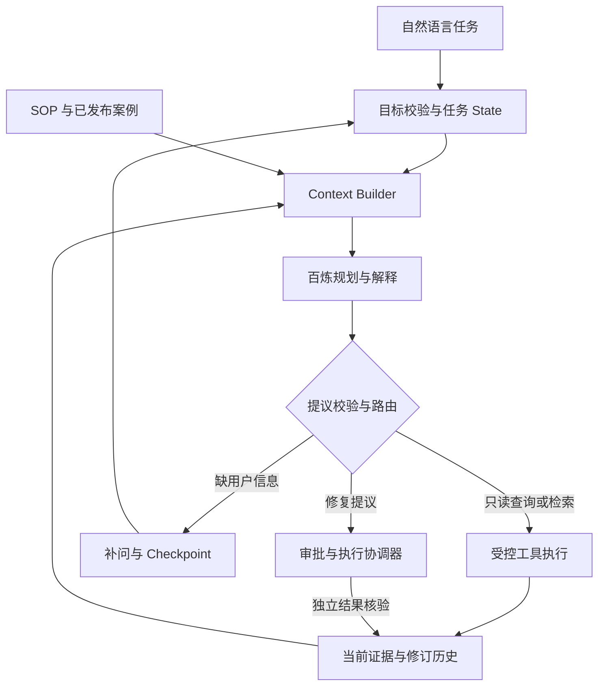

# RetailOps Agent 后续开发路线与 Agent 能力设计

创建：2026-11-12；本次更新：2026-11-16。沿用原文件路径，作为唯一的后续开发路线。仓库与历史文档中的 OmniOps 指同一项目。

本次以 `master@d84e120be010e615370e67e5181c9b770b58a53e` 为代码基线，结合最新百炼运行反馈更新。审查覆盖领域模型、API、任务服务、Runtime、模型协议与当前提示词、工具适配器、持久化、评估程序、测试、场景数据、配置/脚本/CI，以及现有设计和阶段记录。历史阶段文档保留当时的实现与验证结果；它们的“下一步”不覆盖本文。

**决定：暂停围绕单个诊断案例继续调 Prompt，下一项开发 Stage 4A：订单 SOP RAG。** 当前过早结束、假设纠正和报告措辞问题进入 Stage 1F 的明确待办；若缺陷直接阻塞新功能或破坏证据/权限边界，则在该阶段修复。本文是开发计划，不表示这些能力已经实现。

## 1. 项目目标与交付边界

项目定位：**基于证据、知识检索与可信案例记忆的零售订单调查及受控恢复 Agent**。先把“美团订单未进入 POS”的一个业务闭环做完整，形成可以运行、复现、评估、讲解的 AI Agent 工程项目，再扩展库存。

目标用户用自然语言描述订单异常；模型理解任务、解释日志、检索 SOP、提出并修正假设、选择调查工具、比较处理方案；Java 约束权限、校验事实、执行批准的动作并独立验证结果。只确认订单是否存在时继续支持零模型查询。

首个可写入简历的完整版本应包含：自然语言入口 → 有状态调查 → SOP/案例检索 → 带引用的处理提议 → 审批 → 模拟恢复/补推 → POS 独立核验 → 经验候选沉淀，以及效果报告和演示文档。真实模型使用已有百炼配置；美团接口继续模拟，不以 SDK/AppKey 缺失阻塞工程交付。

| 层级 | 需要证明的内容 | 可对外陈述的范围 |
| --- | --- | --- |
| 工程闭环 | 状态、检索、权限、恢复、审批和模拟写后验证可运行 | 订单 Agent 原型/模拟业务闭环；测试替身不证明模型能力 |
| 真实模型效果 | 百炼在独立案例上的轨迹、人工评审、成本和失败结果 | 如实注明模型、样本和业务数据来源，不外推为生产准确率 |
| 真实业务接入 | 对应数据库、日志、平台和写接口完成契约联调 | 只陈述实际接入范围；H2、适配器代码、模拟成功均不是生产验证 |

## 2. 代码审查：已有什么，缺什么

当前并非“没有 State/Context/Checkpoint”，而是已经完成单任务底座，尚缺知识与跨任务经验、写操作闭环和可信效果评估。

| 能力 | 当前代码事实 | 后续缺口 |
| --- | --- | --- |
| LLM 调查 | `InvestigationRunner` 让模型更新假设、选工具、补问；`JsonModelPlanner` 使用严格 JSON 协议 | 调查质量不稳定；缺知识检索和经验利用，不宜用更多审查轮次替代能力建设 |
| State | `AgentState` 保存执行位置、待执行查询、补问、反馈和纠正机会 | 没有修复计划、审批与执行状态；领域边界需随功能扩展 |
| Context | `ContextBuilder` 汇集证据、假设、反证、用户回答、预算与工具说明 | 60000 字符超限即停止；没有分层预算、语义摘要、检索上下文 |
| Checkpoint | `FileTaskRepository` 原子 JSON 快照、文件锁；调查可暂停、补问、重启恢复 | 单进程文件存储，不是数据库任务队列；无持久化审批和动作幂等账本 |
| Memory | 同一任务的答案、假设历史和 Evidence 会保留 | 没有跨任务案例检索、审核发布、有效期与撤销；保存 Trace 不等于长期 Memory |
| 工具执行 | 注册表、有界执行器、目标与门店检查、失败语义、来源标记 | 参数统一为 `storeId/orderId`，模型只见名称/用途；不能直接容纳知识查询和动作方案 |
| 本地订单/POS | 固定 SQL 的 MySQL/SQL Server 只读适配器，默认关闭；有 H2 与配置测试 | 真实数据库联调待完成；POS 接口流水存在不等于业务消费完成 |
| 日志 | 有界读取本地 gzip 副本，按订单/显式 trace 关联事件并裁剪脱敏 | 不连接生产 SSH；脱敏不是完备保证；部分扫描不能证明事件未发生 |
| 美团 | 独立模拟客户端、响应校验、固定模拟时钟、对象与载荷边界检查 | 非真实 SDK；`productionPayloadValidated=false`，不能授权真实恢复 |
| 语义审查 | 按可观察歧义追加同模型审查，持久化意见、一次纠正及再审查 | 审查本身可能误判；引用合法不等于因果成立，根因仍为 `UNCONFIRMED` |
| 评估 | `EvaluationRunner` 对比 10 个状态开发案例；`InvestigationDemoRunner` 导出单次调查 | 没有批量调查评分、独立保留集和 RAG/Memory 消融；固定 Workflow 较弱 |
| 交付 | REST、PowerShell、Markdown/JSON 轨迹、JDK17 CI | 没有交互工作台、部署包、身份认证、版本化效果报告和完整演示脚本 |

当前技术栈为 Java 17、Spring Boot 4.1.2、JDK HttpClient、Jackson；尚未引入 PostgreSQL/pgvector、Embedding 或 Agent 框架。不要把其他学习项目的技术栈当作本仓库现状。

代码中有 29 个具名开发场景（10 个状态、3 个调查、16 个美团场景），另有与之对应的 29 份美团模拟响应，并非 58 个独立案例。现有批量评估只覆盖其中的状态集。基线关联的 [JDK17 CI](https://github.com/Zdanquxunhuan/ayd-retailops-agent/actions/runs/43792030011) 为 144 项测试通过；这些主要证明工程契约，不代表 144 个真实模型任务成功。

### 审查中需要优先处理的设计约束

1. **工具参数必须先扩展。** `Diagnosis.Arguments`、`Investigation.Query`、`ReadOnlyGateway` 和 Runner 目前都假设订单查询参数；新增 `knowledge.search(query, topK)` 时需要类型化协议及服务端权限范围，不能只往 Prompt 加一个工具名。
2. **保留观察，但允许修正解释。** `InvestigationDelta` 和校验器只允许累加旧支持/反证引用，早期错误关联无法撤回。后续保留不可变 Evidence 与修订历史，允许撤销“某条观察支持某假设”的关系；不得直接删除不利证据。
3. **有引用不等于有知识推理。** SOP、历史案例、当前订单观察必须分类型；旧案例或 SOP 不能证明当前订单已收到或某根因已确认。
4. **评估必须进入开发闭环。** 现有 `evaluate` 不等于调查评估；`investigate` 单例运行也不能替代批量质量报告。
5. **文档入口要一致。** 原 `PROJECT_SUMMARY`、项目解读及部分 Stage 文档早于当前代码；本次同步现状入口和后续顺序，历史实测记录不改写为最新成果。

## 3. 开发顺序与完成标准

保留原约定：**Stage 2 → Stage 3 → Stage 4 → Stage 1 → Stage 5 → Stage 6**。Stage 1 已有历史实现，接下来的质量工作称为 Stage 1F；Stage 3C/3D 是订单适配与语义审查，不再指库存。

| 顺序 | 阶段 | 本轮定位 | 阶段出口 |
| --- | --- | --- | --- |
| 已有底座 | Stage 2、3A～3D | 保留并复用，真实接入缺口单列 | 支持订单只读调查、暂停恢复和工具契约 |
| 1 | Stage 4A | 订单 SOP/API 知识 RAG | 模型可检索、引用、据此选择下一步；知识不能覆盖实时证据 |
| 2 | Stage 4B | 可信案例 Memory | 候选、审核、检索、过期和撤销可演示；案例只提供经验 |
| 3 | Stage 4C | 自然语言入口与 Context 工程 | 目标识别/歧义补问、分层上下文、可恢复的多轮调查 |
| 4 | Stage 1F | 调查可靠性与效果基线 | 当前反馈问题闭环；批量调查、强基线与保留集结果可复现 |
| 5 | Stage 5A～5C | 受控订单恢复/补推 | 动作提议、持久化审批、幂等、结果未知对账、独立验证 |
| 6 | Stage 6 | 工作台与求职交付 | 可启动、可演示、可评估；简历描述与证据一一对应 |
| 后续 | 库存扩展 | 验证同一底座的业务复用 | 单门店/单商品调查与受控同步；不重建框架 |

每阶段都执行该功能的必要自动化测试和小规模模型验收。Stage 1F 集中做系统性质量治理，不意味着此前可以跳过契约测试；Stage 4 的工程开发可先用明确标识的测试规划器推进，真实效果未通过必须单列，不宣称整个 Agent 已稳定。

## 4. 大模型在目标架构中的职责

“提升模型比重”以能完成的新任务衡量，不以调用次数衡量。固定状态判断用 Java 更合适；模型的价值在于处理日志表述差异、不完整线索、文档与案例知识，并在多种合理调查/处理路径间做有依据的选择。

| 环节 | 模型工作 | Java 工作 | 需要展示的证据 |
| --- | --- | --- | --- |
| 任务理解 | 从自然语言提出意图、对象和时间候选，识别歧义 | 校验原文跨度、对象目录、授权与时间规范化 | 换一种说法仍可识别；有歧义会补问 |
| 调查规划 | 生成假设、选择最有价值的下一项查询 | 工具参数、权限、预算、结果来源与新鲜度 | 不同线索导致不同工具路径，并能解释理由 |
| 知识应用 | 形成检索问题、解释 SOP 的适用条件 | 文档版本、检索、访问控制、引用检查 | 建议引用具体条款，错误/过期 SOP 不被采用 |
| 案例利用 | 比较相似点与差异，提出复用或拒绝复用理由 | 只检索已发布且在授权范围的记忆 | 同类异常少走无效步骤；相似但不同的案例不误导 |
| 证据综合 | 分清事实/可能原因/缺口，遇反证修正 | 观察不可改写、关系修订可追溯、明确业务门槛 | 不只修改措辞，能撤回不成立的解释 |
| 修复规划 | 比较等待、补证、恢复、补推、转人工等候选方案 | 生成真实载荷、校验前置条件、审批、执行及核验 | 行动理由和排除理由可追溯，执行不靠模型口头保证 |

这是目标架构，RAG、长期记忆、自然语言入口和修复协调器均待实现。复用当前 Java Runtime；不为展示关键词而引入多 Agent、MCP、图数据库、微服务或全量框架迁移。当前 JSON 动作协议已有工具调用语义，原生 Tool Calling 可在后续作为对照实验，不作为修复推理问题的默认答案。

## 5. Stage 4：知识、记忆与上下文

### 4A：订单 SOP RAG——下一项开发

**用户价值：** 模型面对“saveData 连接异常、当前本地缺单、POS 缺单”时，能查到对应业务阶段、恢复前置条件和异常处理 SOP，说明下一步为什么值得查；不能仅凭检索到“数据库故障处理”就认定当前故障原因。

采用 PostgreSQL + pgvector 作为新的 Agent 数据库，存储知识及后续案例/任务元数据，与既有业务 MySQL/SQL Server 分离。先支持 Markdown 导入和标题分块，保留原文定位；不先做复杂文档解析、知识图谱或万能上传平台。

| 子任务 | 实现范围 | 验收 |
| --- | --- | --- |
| 4A-1 知识与工具契约 | 新建 `knowledge/`；`KnowledgeDocument/Chunk/Reference`；工具输入/输出 Schema、版本和 READ_ONLY 类型；保留旧订单工具兼容 | 错参数、超范围和错误引用被拒绝；旧订单与恢复测试不回归 |
| 4A-2 导入与检索 | PostgreSQL 迁移、文档版本/内容哈希、按标题切块、关键词+向量混合检索、去重和 topK 限制 | 重复导入幂等；失效版本不参与当前检索；中文同义问法和错误码均能检索 |
| 4A-3 调查接入 | `knowledge.search`、受控 `knowledge.read`；模型提出检索问题，读取适用条件，生成带引用的建议；Context 预算内返回摘录 | 同一工具可由不同异常问题触发；引用定位到文档版本与段落，未命中不编答案 |
| 4A-4 演示与效果 | 首批约 8～12 份脱敏/合成订单文档及约 20 道检索问题；跑有/无 RAG 的小型对照 | 保存命中/遗漏、引用和建议质量，标明开发集；不把命中率当诊断准确率 |

Embedding 使用独立 `EmbeddingClient` 接口，实施时选择本地 BGE-M3 或账户可用的百炼 Embedding 并固定模型、维度和版本；不能假设聊天模型同时提供向量能力。首版只实现一个真实向量提供方和一个测试替身。无模型凭据时可以验证导入、关键词检索和契约，但必须明确尚未完成真实向量验收；模型或维度变化需重建索引。暂不加入额外 reranker 调用，先用评测决定是否需要。

知识来源分为业务确认 SOP、接口契约和演示资料。先建立以下主题：接收/异步保存/投递/POS 接口流水的阶段含义、数据库连接失败、迟到回执、超时与未知、平台五天查询窗口、订单完整性、补推前置条件、窗口外人工处理。业务事实来源需登记；合成 SOP 必须标记 `DEMO`，不能冒充公司正式制度。

检索工具参数拟为 `query/topK` 和受控文档引用；租户、允许门店、环境和文档状态由服务端注入，不让模型指定权限范围。检索前过滤，读取引用时再次校验。当前没有真实身份系统：本阶段只实现服务端配置的演示访问范围，真实多用户授权在 Stage 5A/6 配套，不能宣称已完成生产多租户。

`KnowledgeReference` 与订单 `Evidence` 分开存储，带文档 ID、版本、chunk、来源、有效期、信任级别、内容哈希和访问范围。引用真实有效只说明条款存在；诊断因果仍需当前订单证据。文档正文是不可信输入，文档中的操作指令不能绕过 Runtime。

**这一阶段的简历证据：** 一次“根据日志检索业务 SOP → 解释适用条件 → 选择下一查询”的真实百炼轨迹，以及检索/引用对照结果。

### 4B：可信案例 Memory

把排障结果变为可审核的经验，而不是自动收录模型答案。初版利用人工核实和合成演示案例，Stage 5 完成后再增加写后验证产生的候选案例。

- `CaseCandidate → REVIEWED/APPROVED → ACTIVE → EXPIRED/REVOKED`：候选可以由模型提炼，发布、撤销和审核人记录由服务端管理。需要拒绝状态及修订记录，不允许改写已发布历史。
- 记忆保存症状、适用环境、关键观察引用、候选原因、排查步骤、处理动作、验证结果、适用限制和有效期；单独记录 `outcomeVerified` 与 `causeConfirmation`。补推成功不能把当时猜测的根因升级为已确认。
- 提供 `case.search`；上下文返回案例摘要、适用条件和差异，不放入原始客户载荷。未审核、过期、越权和已撤销案例不得参与当前推荐。
- 模型输出“与本单哪里相似、哪里不同、还需验证什么”；案例只是检索线索，当前订单状态必须重新查询。
- 记忆读取记录进 Trace；撤销后新任务不再检索，正在执行的任务在发布建议/动作前重新校验有效性。保留历史引用及失效标记，便于回放。

验收至少包含：相似案例帮助选路、表面相似但不同业务阶段、过期 SOP/案例、错误经验被撤销、跨范围不可见、提示注入不进入可执行动作。比较“仅 RAG”和“RAG+Memory”的查询成本与处理质量；没有收益就调整记忆策略，不预设一定提效。

### 4C：自然语言入口与 Context 工程

新增 `TaskIntakeService/IntentResolver`，把“帮我查一下某店这张美团单，十分钟前还没到收银系统”转换为待校验的意图与对象候选。模型返回原文跨度和候选，不编造订单号、门店或时间；Java 用授权目录/规范化规则校验，歧义通过补问确认。保留现有结构化 API，方便自动化和对照。

先支持 `CHECK_STATUS/DIAGNOSE_CAUSE`；用户要求补推时记录“希望获得处理方案”，在 Stage 5 上线前明确不能执行，不把自然语言理解结果当审批。用户补充仍是不可信陈述；“刚才已经修好了”必须通过工具核验。

Context 分层：任务目标与约束、最新关键状态、有效反证、当前假设与知识缺口、SOP 摘录、案例摘要、最近工具轨迹、较早历史摘要。实现 Token 估算与硬预算，记录每层大小和裁剪原因；关键证据与反证不可因摘要丢失。原文仍留在持久化存储，引用可回取；摘要有来源和版本，不能写回为事实。优先确定性裁剪/分层，只有有收益时才用模型摘要，并计入预算。

验收：同义表达、缺单号、门店重名、越权门店、相对时间歧义、多轮补问、长轨迹压缩后仍保留反证、暂停恢复后引用可定位。单次任务回答、知识检索和长期案例是不同的数据来源，必须在 UI/报告和 Trace 中可区分。

## 6. Stage 1F：调查质量与可量化评估

### 已登记、暂缓逐例优化的问题

2026-11-16 用户上传的 `trace(4).json` / `report(4).md`（任务 `64c6b5c8-dd65-4b95-a5a2-08c701b869ab`）显示：v15 在 Java 采集 POS/本地两条观察后，模型仅调用一次便提出结束；未查历史，触发 `INSUFFICIENT_INVESTIGATION`。当前纠正分支不处理该码，仍有预算也直接停止。这是调查覆盖不足且被拦截，不是成功查明原因。

| 待办 | 修改方向 | 验收边界 |
| --- | --- | --- |
| 未调查便结束 | 区分未查询、查询失败、查无记录；对可恢复的覆盖不足反馈一次受预算约束的纠正 | 该取证时能继续；确无可用来源时允许正确保留未知，不强制遍历所有工具 |
| 错误支持/反证关系无法撤回 | Evidence 不变，新增可审计的关系修订/撤销；同步协议、校验器与持久化版本 | 旧错误关联可纠正，原始观察与修订理由都可回放 |
| 语义过强与审查误判 | 接收/保存/投递/入库分阶段；检查审查意见的引用和针对性；分析是否值得触发审查 | 简单明确案例短路径；反证/歧义有检查；同模型审查不当事实裁判 |
| Prompt 累积与协议负担 | 统一有效指令和工具 Schema；清理冲突要求，历史版本保留；改变协议需迁移说明 | 一组同义改写和未知异常通过，不能只修一个固定字符串 |
| 报告含糊 | 区分已有原因线索、无已接受线索、恢复建议未知、调查失败 | 没有 accepted claims 时不能暗示“上方已发现线索”；拒绝的提议不作结论 |
| 时效与续跑 | 区分事件发生时间、读取时间、当前状态 TTL、历史快照有效性 | 不能延长旧状态冒充实时；历史记录不因等待就丢失可审阅价值 |
| 预算与可复现性 | 统一统计调查、审查、纠正、检索/摘要成本；补 Git SHA/构建版本 | 明确任务预算与进程额度差异；失败也计成本，缺失 usage 标未知而非零 |

上一份 v14 样本出现正常日志调查路径，只说明该次运行有效；不能拿不同版本的两次单例推断稳定性。本阶段保留这些失败样本作开发回归，并另外建立未用于调 Prompt 的保留集。

### 评估系统与口径

新增 `InvestigationEvaluationRunner`，支持批量案例、重复运行、逐项评分和可回放产物。现有 `evaluate` 继续标为状态评估；新增调查评估入口不得静默复用错误评分。先建立约 40 个场景的开发/验证/保留划分（例如 20/10/10，数量是计划），按事件模板和故障族分组，防止同一日志轻微改写泄漏到两边；已用于修 Prompt 的样本不能再当保留集。

覆盖：明确数据库保存异常、迟到回执、历史不足、跨阶段来源混淆、平台失败/多候选/窗口外、部分 POS 流水、查询顺序变化、补问与恢复、SOP 版本冲突、相似错误记忆、长上下文反证、注入/越权。答案标注的是“可支持结论、禁止推断、关键证据、允许的下一动作与未知项”，不是唯一工具调用顺序。

| 对照 | 公平条件 | 回答的问题 |
| --- | --- | --- |
| 强 Java Workflow vs 模型调查 | 相同数据/工具/授权；Workflow 有合理重查、已知规则及 SOP，不故意弱化 | 复杂表述、未枚举组合与信息不足时，模型能增加多少覆盖 |
| 单轮 LLM vs 多轮调查 | 相同总工具/请求上限、相同初始资料；单轮不偷看未来结果 | 观察后再规划是否值得额外成本 |
| 调查无 RAG vs 有 RAG | 同模型、Prompt 主契约、案例、预算上限 | 知识是否提高建议正确性和依据可查性 |
| 仅 RAG vs RAG+Memory | 案例库版本固定、排除测试题答案及本题历史 | 记忆是否减少无效查询，是否引入误导 |
| 全量上下文 vs 分层上下文 | 同一任务回放及配对运行，关键事实不变 | 压缩后质量是否保持、输入 Token 是否减少 |

不必一次跑全组合。先小批筛查，再在确认的请求/费用预算内进行配对重复运行（目标每例至少 3 次；若预算不足，报告实际次数，不声称统计稳定）。记录模型 ID、参数、Prompt/Schema/数据集/知识库/案例库哈希、代码版本、业务来源、停止原因及完整轨迹。保留集用于最终评估，不能看过结果继续调优后仍称“未见过”。

指标分别报告：任务成功率（含错误/拒绝/耗尽的总分母）、正确保留未知率、关键证据覆盖、无依据因果断言率、引用有效性与人工支持性评分、RAG Recall@K、记忆误用、平均/p95 延迟、模型/工具次数、输入/输出 Token、重试与审查成本。失败不得从分母消失；安全拦截率与调查成功率分开。小样本 p95 只作描述，金额按实际账单或明确标价日期估算。

自动评分负责结构和明确事实，人工复核负责语义与因果；LLM-as-judge 只作辅助并与人工结果校准，不能由同一模型自评后宣布成功。初版必须发布失败分类，不预填“准确率提升 30%”“耗时下降 80%”等数字。

阶段出口：工程安全回归通过；登记缺陷有可复现结果；冻结评测口径与版本；给出有/无模型能力的实测对照、适用范围和已知失败。不要求所有任务都给根因，正确拒答是有效业务结果，但协议错误导致的拒答不是。

## 7. Stage 5：订单处理方案、审批和受控执行

### 5A：动作状态与持久化基础

提取 `TaskRepository/CheckpointStore` 接口，保留文件实现用于轻量演示；新增 PostgreSQL 实现及迁移、乐观锁、审批记录、执行尝试和幂等账本。先单 Worker，测试事务边界和进程重启；不因用了数据库就声称分布式恢复或 exactly-once。

引入服务端身份与角色边界：提交人、审批人、执行服务及允许门店。演示身份可以来自本地固定测试用户，必须标记；真正开放给多用户前接入认证并校验任务、证据、知识、审批和导出访问。不能信任请求正文自行填写的 actor/tenant。审批是否允许自批由配置明确，不假装本地单人演示具备企业职责分离。

### 5B：模型处理提议与审批

引入 `RepairPlanner`，复用百炼与预算。输出候选动作、适用条件、引用的当前证据/SOP/案例、风险、备选方案和仍缺的信息。动作限于服务端定义的枚举：等待/补证、转人工、恢复本地订单、补推 POS；不要让模型生成 SQL、HTTP 地址或订单正文。根因尚未确认不必阻止一切恢复，但每项动作必须有独立可验证的业务前置条件。

Java 的 `RepairPolicy/ActionAssembler` 根据权威数据构造实际载荷与 `ActionSnapshot`，包含目标、动作、载荷哈希、证据版本/时效、方案版本、环境和过期时间。审批绑定完整快照；补问、重新规划、目标或载荷变化导致旧审批失效。批准后执行前再查 POS 及其他必要前置条件，避免已经到账仍补推。

`LOCAL_JDBC` 元数据 FOUND 不代表载荷有效；模拟美团的 `payloadValidated=true` 不能满足真实写操作资格。真实恢复必须取得并校验真实完整订单及匹配对象，不能由 LLM 补齐缺失商品字段。审批是业务执行授权，不等于确认模型根因正确。

### 5C：模拟闭环、结果未知对账与独立核验

新增只接受批准动作的执行协调器和独立写网关，不能在只读 `ToolRegistry` 塞入写 Handler 绕过审批。先实现隔离的可变模拟订单/POS 后端：执行真的改变该模拟后端状态，再由查询适配器读回验证。每个案例独立初始化，禁止直接让写接口返回 SUCCESS 或静态 fixture 的 FOUND 充当闭环证明。

动作最小状态包括 `PROPOSED → WAITING_APPROVAL → APPROVED → EXECUTING → VERIFYING → VERIFIED`，以及 `REJECTED/EXPIRED/FAILED/UNKNOWN/NEEDS_HUMAN`。动作与任务状态分别保存，恢复时从账本和查询结果决定下一步。

| 故障或变化 | 必须出现的行为 |
| --- | --- |
| 同一请求重复提交/执行 | 唯一幂等键绑定同一目标和动作快照；重复请求读取原记录，不产生第二次业务副作用 |
| 调用超时或执行后断电 | 进入 UNKNOWN，对账后再决定；不盲目重试未知结果，不承诺外部服务恰好一次 |
| 审批后 POS 已存在 | 新观察阻止重复补推，记录跳过原因；审批不强迫执行 |
| 两张 POS 接口表仅一张存在 | 按现有业务边界视为已有接收线索，停止自动补推，人工核实部分接收 |
| 本地缺单且平台载荷不完整/来源模拟混用 | 不形成真实可执行恢复动作，说明前置缺口 |
| 恢复本地成功、补推失败 | 分别记录两个动作结果；不回滚已恢复订单，不把半成功写成全成功 |
| 推送返回成功，独立 POS 查询失败/未命中 | 不标 VERIFIED，进入核验/对账或转人工；响应成功不等于实际接收 |
| 窗口外且没有可用本地订单 | 提示门店人工补推；时间依据不足时保留未知，不推断平台故障 |

用户确认的业务预期是补推后 POS 接口流水立即出现，首版据此立即独立查询；若未来真实契约允许延迟，显式配置有界核验策略，不用无限重试掩盖问题。真实 MySQL/SQL Server、平台和补推服务逐个契约联调；无真实接口时交付模拟闭环并保留待办。

**简历证据：** 模型基于 SOP 与现状提出方案，人工审批后执行；演示一次正常完成和一次“请求结果未知 → 重启 → 对账 → 不重复写入”，展示幂等账本、审批绑定和独立 POS 验证。

## 8. Stage 6：可展示、可复现的求职版本

### 工作台与运行交付

提供最小 Web 工作台：自然语言任务、补问回答、任务时间线、当前事实/模型假设/知识引用、动作差异与审批、独立核验结果、来源与版本。界面复用已有 API，事件先轮询即可；流式/SSE 只在有实际价值时增加。不要展示隐藏思维链，展示决策摘要、选工具理由、引用及拒绝原因。

提供 Docker Compose（应用、Agent PostgreSQL/pgvector、可选本地向量服务）、环境模板、迁移/初始化/清理演示数据脚本，保留 Windows PowerShell 与项目级 JDK17 的启动方式。默认模拟业务、无模型密钥可跑工程演示；显式选择 qwen 后运行真实模型。跨机器或多人访问前完成认证、授权和导出脱敏，不能仅去掉当前 localhost/profile 限制。

观测指标至少含任务完成/转人工/失败、工具错误与延迟、模型请求与 Token、检索命中、审批与执行状态、UNKNOWN 待对账数量。统一 taskId/traceId/actionId，记录真实/模拟来源。先结构化事件及指标端点，再按需要接 OpenTelemetry；不把接一个监控组件当效果证明。

### 简历与演示材料

新增 `presentation-document.md`：配置与启动、一个正常订单调查、一次反证重规划、一次补问重启恢复、一次 RAG/Memory 使用、一次审批写后验证、一次未知结果对账；每个例子标注入口类、主链路、证据文件和限制。配套架构图、5～8 分钟录屏、固定版本演示数据和脱敏评测报告。

| 简历能力 | 代码/产物证据 | 表述条件 |
| --- | --- | --- |
| Agent 规划与工具编排 | 模型动态选路、反证更新、失败轨迹 | 当前已有原型；不能把规则 Stub 的分支当模型推理 |
| State/Context/Checkpoint | 同一任务补问、重启恢复、累计预算 | 当前可写单机能力；数据库版本完成后再升级描述 |
| RAG 与知识驱动决策 | 文档导入、混合检索、引用、策略变化及消融 | Stage 4A 验收后可写，不能只写“接入向量库” |
| 长期 Memory | 案例审核、检索、失效、差异比较 | Stage 4B 完成后可写；不能把聊天历史称为可信长期记忆 |
| Context 工程 | 分层预算、可回取引用、压缩前后效果 | Stage 4C 完成并有对照数据后可写 |
| Human-in-the-loop 与可靠执行 | 审批快照、幂等、UNKNOWN 对账、独立验证 | Stage 5 完成后可写；业务接口模拟须注明 |
| LLM 评测与成本治理 | 强基线、保留集、失败分布、Token/延迟 | 有实测数据后填写具体数值和分母 |

项目完成后的描述模板（**当前不能直接当已完成事实使用**）：

> 基于 Java/Spring Boot 与百炼构建零售订单排障 Agent，结合订单/日志工具、SOP RAG 和经审核案例记忆，实现多轮调查、证据驱动的方案规划、Checkpoint 恢复及人工审批后的模拟恢复/补推；通过幂等账本、未知结果对账和独立 POS 查询验证执行结果。在明确版本的保留集上与强 Java Workflow 对比，报告任务成功率、无依据断言率与 Token/延迟成本。

面试应能讲清三件事：哪些判断不需要模型；模型在哪些未枚举表述或证据组合上增加价值；模型犯错、超时、审批后状态变化时系统如何处理。招聘能力映射基于本项目设计，不代表本次做过实时岗位市场统计。

## 9. 库存扩展与暂不做的内容

订单完成 Stage 6 后再扩展库存，复用 Runtime、任务存储、工具 Schema、RAG/Memory、评估和审批。业务增量仅包括：本地库存/平台 SKU/同步记录工具、库存 SOP 与案例、专用前置校验和写后核验。

- 单门店、单商品；`axcode=store_id`，`spucode=app_spu_code`。目标数量只由 `stock` 决定，不能从上架/销售状态推算库存。
- 原始编码、空白字符、映射与实际请求均作为证据保留；不能提前 trim 后抹掉线索。Java 可检测字符差异，模型判断其与平台错误、映射或库存现象的关系并选后续验证；发现空格本身不证明唯一根因。
- SKU 不唯一则补问或停止；同步审批绑定本地库存与映射快照，执行前复查，执行后记录发送目标、平台当前值和本地当前值，处理并发漂移。
- 库存扩展的价值是证明底座可复用，不是再造第二套 Agent。退货、京东、多 Agent 协作、分布式调度、微调/训练和自动改生产配置暂不纳入首个求职版本。

## 10. 下一轮可直接执行的开发批次

**先做 4A-1/4A-2，再做 4A-3/4A-4。** 本批不重做整体 Runtime，不扩库存，不继续单独润色 v15 的一个案例。

1. 为订单查询与知识检索定义不同参数类型；统一工具 Schema、服务端访问范围与只读执行协议。对接 `Investigation.Query/ReadOnlyGateway/InvestigationRunner`，保留已有契约回归和旧快照兼容策略。
2. 新增 Agent PostgreSQL/pgvector 的启动配置与数据库迁移；完成 Markdown 导入、版本记录、分块、向量/关键词检索及引用读取。首批先放可公开的演示 SOP，业务确认内容另行登记来源。
3. 让百炼通过 `knowledge.search/read` 根据调查需要检索；Context 加入独立的知识引用块，输出“适用条款、当前观察、建议查询与缺口”。不强制每轮检索，不把知识引用塞入订单事实列表。
4. 用工具契约/检索/API 测试验证主链路；用已确认的模型预算跑少量有/无 RAG 对照，保存成功与失败。若真实模型条件不可用，交付工程结果并准确标明待验收部分。
5. 新增 `docs/stage4a-order-rag.md` 记录实现、运行方法、验收和限制，并回写本文第 2/3 节的完成状态；阶段文档负责记录已交付事实，本文持续维护后续路线。

阶段交付时统一检查：代码与说明可运行、必要回归通过、模型效果与工程测试分开登记、真实与模拟来源清晰、待办有明确后续归属。当前百炼配置沿用，不在文档保存密钥；本次路线整理不包含新增模型调用或生产写操作。
